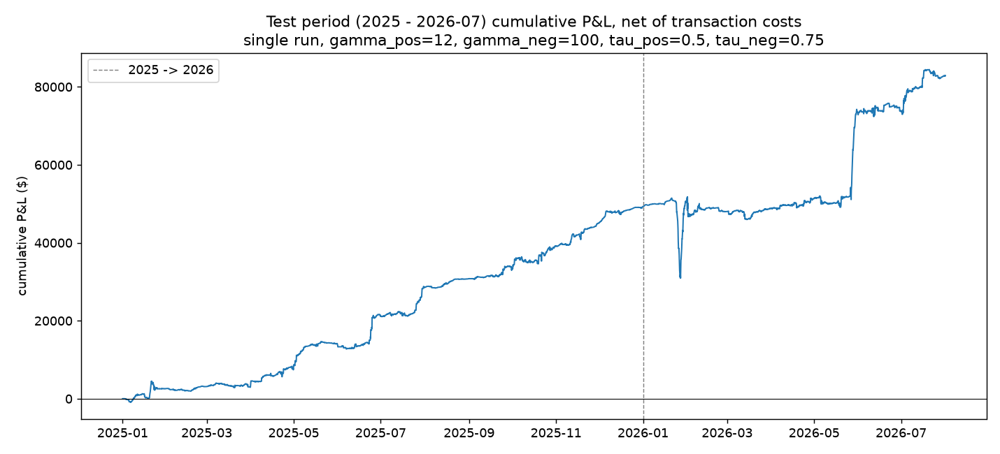

<div align="center">

# PJM DART Spike Prediction

**Point-in-time classification of extreme day-ahead vs. real-time price spreads in PJM Dominion, translated into virtual INC/DEC signals.**

[](https://www.python.org/)
[](https://scikit-learn.org/)
[](LICENSE)

[Research paper](https://arxiv.org/abs/2601.05085)

</div>

## Results

| Holdout | Net P&L | Annualized Sharpe | Max drawdown | Trades |
|---|---:|---:|---:|---:|
| Jan 2025–Jul 2026 | **$82,926** | **2.78** | $20,525 | 11,943 |

Net of **$0.0644/MWh** modeled transaction costs; one 1 MWh position per signal.



| Strategy | Net P&L | Sharpe |
|---|---:|---:|
| **Spike classifier** | **$82,926** | **2.78** |
| Always INC | −$42,704 | −1.05 |
| Always DEC | $40,920 | 1.01 |
| Random, matched frequency (2,000 runs) | −$17,927 ± $9,284 | — |

| Side | Spike definition | Probability threshold | Precision | Recall | Trades |
|---|---:|---:|---:|---:|---:|
| INC | DART ≥ $12/MWh | 0.50 | 0.322 | 0.710 | 8,743 |
| DEC | DART ≤ −$100/MWh | 0.75 | 0.099 | 0.466 | 3,200 |

## Methodology

The project predicts distribution tails—not the point value of
`DART = day-ahead LMP − real-time LMP`.

| Stage | Design |
|---|---|
| Market | Hourly PJM Dominion (`DOM`) day-ahead and real-time LMP |
| Point-in-time control | Features use only information available before the 11:00 EPT day-ahead gate; load forecasts are selected by publication vintage |
| Features | 24/48-hour DART lags; DOM/RTO load forecasts and recent forecast errors; hour, month, weekend, holiday, season, and peak flags |
| Model | Two standardized, class-balanced L2 logistic regressions—one for positive spikes and one for negative spikes |
| Validation | Chronological split: 2019–2023 train, 2024 threshold selection, 2025–Jul 2026 locked holdout |
| Trading rule | INC for positive-spike signals, DEC for negative-spike signals; overlapping signals resolve to the higher-confidence side |
| Evaluation | Precision/recall, net P&L, daily annualized Sharpe, max drawdown, and frequency-matched baselines |

## Reproduce

```bash
git clone https://github.com/whoIsClownHere/pjm-dart-prediction.git
cd pjm-dart-prediction
python -m venv .venv
source .venv/bin/activate
pip install -r requirements.txt
```

Add a GridStatus API key to `.env`:

```dotenv
GRIDSTATUS_API_KEY=your_key
```

```bash
mkdir -p input_data
python -m scripts.data.data_collection
python -m scripts.data.features
pytest -q
```

Calibration and holdout analysis are documented in [`analysis/models.ipynb`](analysis/models.ipynb).

## Scope

Research backtest, not investment advice. Results cover one zone and one holdout window. Unit-size trading ignores price impact; modeled costs are a lower bound, and profits are concentrated in a small number of events.

Methodology adapted from Hubert, Lolas & Sircar, [*Trading Electrons: Predicting DART Spread Spikes in ISO Electricity Markets*](https://arxiv.org/abs/2601.05085) (2026).
